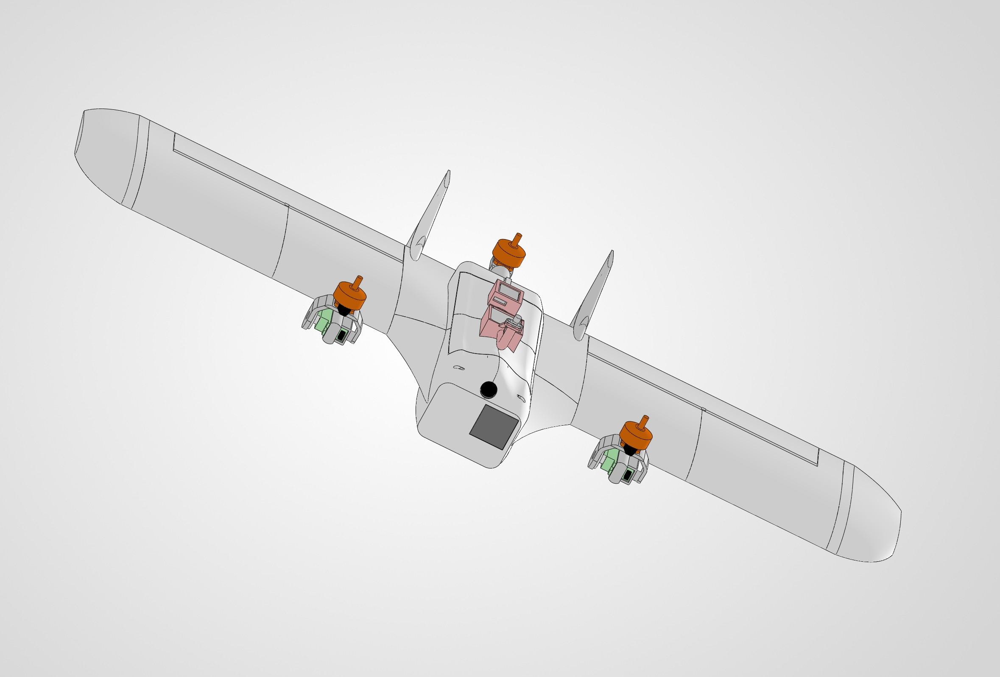
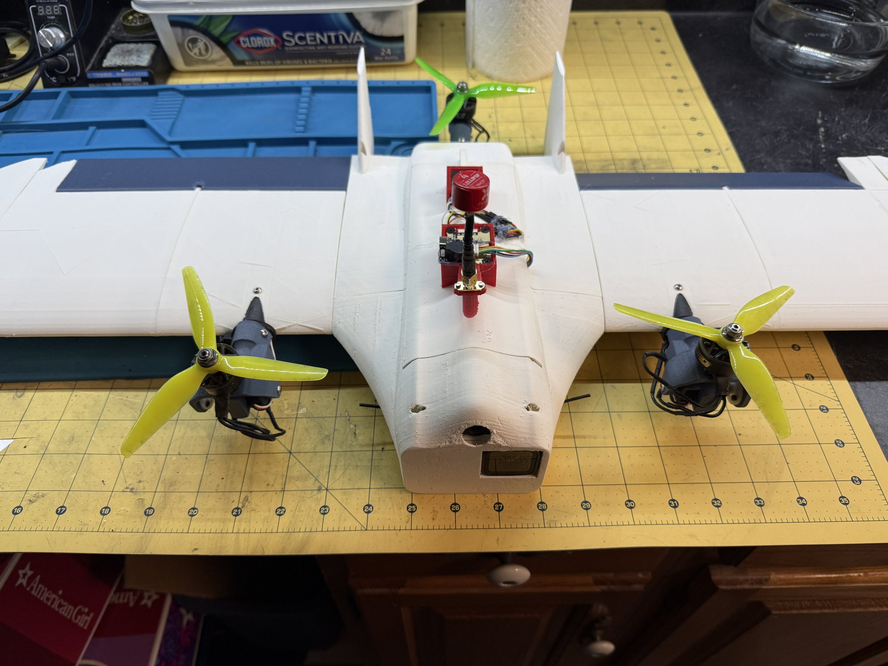

# 3D Printed Tiltrotor VTOL

A tricopter tiltrotor flying wing that I designed, built, and flight tested from scratch. It takes off and lands vertically, transitions to efficient forward flight, and carries a GoPro Hero 11, with fully autonomous flight as the end goal.

<table>
  <tr>
    <td width="50%"></td>
    <td width="50%"></td>
  </tr>
  <tr>
    <td align="center"><em>CAD model</em></td>
    <td align="center"><em>Built aircraft</em></td>
  </tr>
</table>

### **[View the full project write-up →](https://https://isaac542.github.io/3D-Printed-Tilt-rotor-VTOL/)**

## At a Glance

- **Configuration:** 800 mm wingspan plank flying wing, two tilting front motors and a fixed rear motor, MH 45 airfoil
- **Status:** Successfully transitions between hover and forward flight; currently tuning forward flight ahead of autonomous missions

The full write-up walks through the design process from start to finish, including aerodynamic sizing, the tilt mechanism, structural design, three airframe revisions, and flight test tuning.
